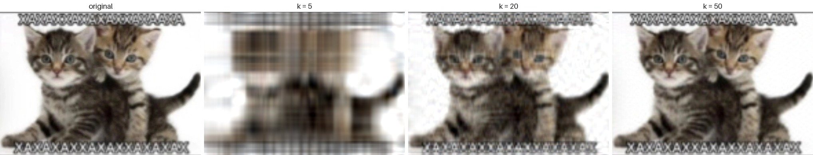
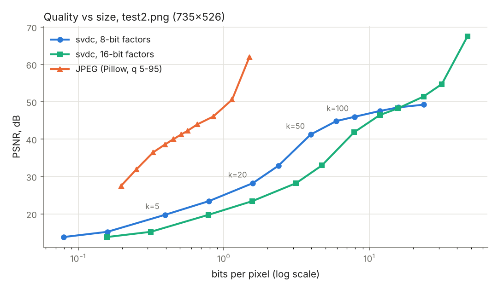
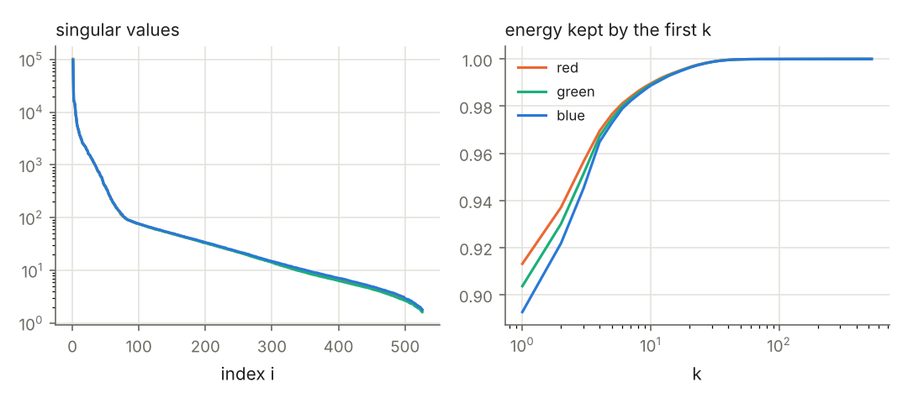

# SVD image compressor

[](https://github.com/buklinfur/SVD-img-compressor/actions/workflows/ci.yml)

A lossy image codec built on the truncated singular value decomposition, written
in plain C11 with **no linear-algebra libraries**: both SVD solvers (an exact
one-sided Jacobi method and a randomized top-k method) are implemented from
scratch on top of the C standard library and `libm`. Images are read and written
with the single-header [stb](third_party/stb) libraries, which are vendored, so
a fresh clone builds with one command.



*Rank-k approximations of a 735×526 meme, per RGB channel. File sizes:
k = 5 → 18.7 KiB, k = 20 → 74.6 KiB, k = 50 → 186.5 KiB (raw pixels: 1.11 MiB).*

- Own SVD: Householder QR with column pivoting + one-sided Jacobi rotations
  (the structure of LAPACK's `xGEJSV`), and a randomized range finder with power
  iterations (Halko–Martinsson–Tropp) for the top-k case
- Agrees with `numpy.linalg.svd` to ~1e-13 (relative to σ₁), checked in CI
- Real compressed format (`.svdc`) with quantized factors, `compress`, `decompress`,
  `info` and `bench` commands
- Any image size, grayscale / gray+alpha / RGB / RGBA, PNG, JPEG, BMP, TGA input
- Clean under `-Wall -Wextra -Wpedantic -Wconversion -Werror`, AddressSanitizer,
  UBSan and valgrind; CI builds and tests it on Linux (gcc, clang), macOS (clang)
  and Windows (MSVC)
- Optional OpenMP parallelism over channels

## How it works

A grayscale image is an m×n matrix A. Its singular value decomposition

    A = U Σ Vᵀ = σ₁ u₁v₁ᵀ + σ₂ u₂v₂ᵀ + … ,   σ₁ ≥ σ₂ ≥ … ≥ 0

writes it as a sum of rank-one "layers" ordered by importance. Keeping only the
first k terms gives A_k, and by the **Eckart–Young theorem** no rank-k matrix is
closer to A: ‖A − A_k‖²_F = σ²_{k+1} + … + σ²_r. Storing A_k takes
k·(m + n + 1) numbers instead of m·n, which is the whole idea of the codec: each
channel is factorized separately, and only U_k, Σ_k and V_k are written to disk.

### SVD solver 1: one-sided Jacobi (exact, `--method jacobi`)

Hestenes' method orthogonalizes the columns of A by plane rotations; when all
columns are mutually orthogonal, their norms are the singular values. To make
it fast it is run on a preconditioned matrix (Drmač & Veselić 2008):

1. Householder QR with column pivoting, A·P = Q·R (|R_jj| non-increasing).
2. One-sided Jacobi on X = Rᵀ: for each column pair (p, q) the rotation angle
   that zeroes ⟨x_p, x_q⟩ comes from t² + 2ζt − 1 = 0, ζ = (‖x_q‖² − ‖x_p‖²) / (2⟨x_p, x_q⟩),
   taking the smaller root (Rutishauser), so the rotation never exceeds 45°.
3. **Stopping rule:** a pair is considered orthogonal when
   |⟨x_p, x_q⟩| ≤ m·ε·‖x_p‖·‖x_q‖ (ε = machine epsilon); iteration stops after
   the first sweep in which every pair passes (a safety cap of 40 sweeps;
   an 868×1541 photo channel needs 11).
4. U = Q·V_x and V = P·U_x.

The method is backward stable and never forms AᵀA, so it does not square the
condition number. Cost is O(mn²) for the QR plus O(n³) per sweep. Rotating Rᵀ
instead of A, column pivoting and a vectorizable dot product took the exact SVD
of an 868×1541 channel from 20.7 s to 7.8 s.

### SVD solver 2: randomized top-k (default, `--method randomized`)

For compression only the leading k triplets matter, so the default solver
(Halko, Martinsson & Tropp 2011, algorithms 4.4 and 5.1) works on a sketch:

1. Y = A·Ω with a Gaussian n×(k + p) matrix Ω (p = 10 oversampling columns;
   seeded splitmix64 + Box–Muller, so results are reproducible).
2. q = 2 power iterations Y ← A·(Aᵀ·Y), re-orthonormalizing after every product
   (Gram–Schmidt applied twice) so that small singular directions survive rounding.
3. B = Qᵀ·A is only (k + p)×n; its exact SVD is computed with the Jacobi solver
   above, and U = Q·U_B.

Cost is O(mnk). If k + p reaches min(m, n) the solver simply falls back to the
exact Jacobi SVD. Its error stays within a few percent of the Eckart–Young
optimum (0.2% on a real image channel, whose spectrum decays quickly).

### Choosing k

`-k N` keeps N triplets per channel. `--energy F` instead picks, per channel,
the smallest k with σ₁² + … + σ_k² ≥ F·‖A‖²_F; with the randomized solver the
sketch size doubles until the target is met. Note that for raw pixel intensities
the first triplet carries the mean brightness, so even k = 1 holds ~90% of the
energy: useful targets are 0.99 and above (see [limitations](#limitations)).

## Building

Requirements: a C11 compiler and CMake ≥ 3.14 (or just GNU make).

```sh
git clone https://github.com/buklinfur/SVD-img-compressor.git
cd SVD-img-compressor
cmake -B build && cmake --build build      # produces build/svdc
ctest --test-dir build                    # unit, CLI and numpy cross-check tests
```

Without CMake: `make` (builds `build-make/svdc`), `make test`, `make OPENMP=1`.

| CMake option | default | effect |
|---|---|---|
| `SVDC_OPENMP` | `ON` | compress color channels in parallel if OpenMP is found (not with MSVC, whose OpenMP 2.0 does not work in C11 mode) |
| `SVDC_WERROR` | `OFF` | treat warnings as errors (used in CI) |
| `SVDC_SANITIZE` | `OFF` | AddressSanitizer + UndefinedBehaviorSanitizer |
| `SVDC_NATIVE` | `OFF` | `-march=native` (≈20% faster Jacobi on AVX2 machines) |
| `SVDC_BUILD_TESTS` | `ON` | build the tests |

## Usage

```text
$ svdc compress examples/test2.png kittens.svdc -k 50
examples/test2.png: 735x526, 3 channels -> kittens.svdc
  k = 50, 50, 50 (randomized SVD, 8-bit factors)
  size 186.5 KiB, 6.1x smaller than raw pixels (1.11 MiB), 1.57x vs input file (292.6 KiB)
  PSNR 41.23 dB, time 0.149 s

$ svdc decompress kittens.svdc kittens_k50.png
kittens.svdc -> kittens_k50.png (735x526, 3 channels), 0.048 s

$ svdc compress examples/test2.png kittens.svdc --energy 0.99
  k = 11, 11, 12 (randomized SVD, 8-bit factors)
  ...

$ svdc bench examples/test2.png --ks 5,20,50,100 --csv results.csv
examples/test2.png: 735x526, 3 channels, raw 1.11 MiB, file 292.6 KiB, randomized SVD, 8-bit factors
     k         size  ratio(raw)  ratio(file)   PSNR dB  compress s  decompress s
     5     18.7 KiB       60.6x       15.67x     19.75       0.034         0.011
    20     74.6 KiB       15.2x        3.92x     28.21       0.095         0.018
    50    186.5 KiB        6.1x        1.57x     41.23       0.170         0.048
   100    373.0 KiB        3.0x        0.78x     45.97       0.352         0.093
```

The reported PSNR is always measured on what a decoder will produce, i.e. after
quantization. Other options: `--method jacobi|randomized`, `--bits 8|16|32`,
`--power-iters`, `--oversample`, `--seed`, `--threads`, `-q`; `svdc --help`
lists them all. `bench --save prefix` also writes the reconstructions as PNG.
Constant channels (such as a fully opaque alpha channel) are stored as a single
byte. Exit status is 0 on success, 1 on runtime errors and 2 on usage errors.

## Results

All numbers below are produced by `svdc bench` and
[`scripts/make_figures.py`](scripts/make_figures.py), which regenerates the
figures and tables in this README. Machine: 2 vCPU Intel Xeon @ 2.8 GHz,
gcc 13, `-O3`, no `-march=native`.

**Size and quality vs k** (`examples/test2.png`, 735×526 RGB, 8-bit factors,
randomized SVD; raw pixels are 1.11 MiB, the PNG itself 292.6 KiB):

| k | file size | vs raw | bits/pixel | PSNR, dB | compress, s |
|--:|--:|--:|--:|--:|--:|
| 1 | 3.8 KiB | 301.3x | 0.08 | 13.81 | 0.027 |
| 5 | 18.7 KiB | 60.6x | 0.40 | 19.75 | 0.032 |
| 10 | 37.3 KiB | 30.3x | 0.79 | 23.41 | 0.041 |
| 20 | 74.6 KiB | 15.2x | 1.58 | 28.21 | 0.069 |
| 30 | 111.9 KiB | 10.1x | 2.37 | 32.88 | 0.094 |
| 50 | 186.5 KiB | 6.1x | 3.95 | 41.23 | 0.148 |
| 100 | 373.0 KiB | 3.0x | 7.90 | 45.97 | 0.350 |
| 200 | 745.9 KiB | 1.5x | 15.81 | 48.50 | 1.130 |



**Honest comparison with JPEG.** At equal size JPEG is far better: it reaches
41 dB at 0.5 bits per pixel, while the SVD codec needs ~4 bits per pixel for
the same quality. This is expected and is the main lesson of the project: a
truncated SVD is the *optimal low-rank* approximation, but images are not
low-rank in general. Fine detail costs whole rank-one layers spanning the full
image, while JPEG spends bits locally (8×8 DCT blocks), exploits human
perception (chroma subsampling, quantization tables) and entropy-codes the result.

This particular image is friendlier to SVD than a typical photo: the spectrum
below has a sharp knee near i ≈ 80 (the meme looks like an upscaled
low-resolution picture, so its effective rank is small), which is why PSNR jumps
from 33 dB at k = 30 to 41 dB at k = 50. Past that point the 8-bit factors hit
their quantization ceiling (~49 dB), and from k ≈ 150 on the 16-bit factors
give better quality per byte; below it 8 bits are always the better choice.



**Speed** (868×1541 RGB photo, `examples/img.jpg`, k = 50 unless noted):

| solver | 1 thread | 2 threads (OpenMP over channels) |
|---|--:|--:|
| randomized, k = 50 | 0.94 s | 0.45 s |
| randomized, k = 200 | 4.16 s | 2.63 s |
| Jacobi (exact, all 868 triplets) | 21.0 s | 14.5 s |

Three channels on two cores bound the channel-level speedup at 1.5× for the
compute-bound Jacobi solver. The randomized solver loses at most 0.05 dB of
PSNR against the exact one (test2.png, k = 5…200; the exact SVD of all three
channels takes 2.5 s, the randomized one 0.03–1.1 s depending on k).

**Accuracy** (`tests/numpy_check.py`, run in CI): the Jacobi SVD matches
`numpy.linalg.svd` with max |σᵢ − σᵢ^np| / σ₁ ≤ 6e-14,
‖A − UΣVᵀ‖/‖A‖ ≤ 1.2e-13 and ‖UᵀU − I‖, ‖VᵀV − I‖ ≤ 1.7e-13, including a matrix
with condition number 1e12 and a rank-deficient one. The randomized top-20
error is at most 1.4% above the Eckart–Young optimum (Gaussian noise, the worst
case for sketching) and 0.2% above it on an image channel.

## File format (`.svdc`, version 1)

All integers are little-endian, floats are IEEE-754 binary32.

| offset | size | field |
|--:|--:|---|
| 0 | 4 | magic `SVDC` |
| 4 | 1 | version (1) |
| 5 | 1 | bits per factor value: 8, 16 or 32 |
| 6 | 1 | number of channels, 1–4 |
| 7 | 1 | reserved (0) |
| 8 | 4 | width (u32) |
| 12 | 4 | height (u32) |
| 16 | … | one block per channel |

Channel block:

| field | size | notes |
|---|---|---|
| type | u8 | 0 = constant channel, 1 = low rank |
| value | u8 | constant channels only |
| k | u32 | low rank: number of triplets, 1 ≤ k ≤ min(width, height) |
| σ₁ … σ_k | k × f32 | singular values |
| U columns | k × (scale + height values) | column-by-column |
| V columns | k × (scale + width values) | column-by-column |

With 8 or 16 bits, each column stores an f32 scale (its max |entry|) followed by
signed integers q, decoded as q / 127 · scale or q / 32767 · scale; with 32 bits
the values are raw f32 and there is no scale. A low-rank channel therefore costs
about k·(width + height) bytes at 8 bits. The parser validates every field and
the remaining length before allocating, and rejects truncated files and
trailing data (the tests try every prefix and every single-byte corruption of a
file).

## Project layout

```text
src/matrix.[ch]    dense row-major matrix, products, Gram-Schmidt
src/svd.[ch]       Jacobi and randomized SVD, energy-based rank selection
src/image.[ch]     image I/O (stb), channel <-> matrix conversion
src/codec.[ch]     per-channel compression, .svdc encoder and decoder
src/metrics.[ch]   MSE / PSNR, wall-clock timer
src/main.c         command line interface
src/stb_impl.c     the only translation unit that compiles stb
tests/             unit tests, CLI tests, numpy cross-check
scripts/           README figure generator
third_party/stb/   vendored stb_image / stb_image_write (MIT / public domain)
```

## Limitations

- **It is not competitive with JPEG/WebP** (see above); it is a study of
  low-rank approximation, not a production codec.
- `--energy` is measured on raw intensities, where the mean dominates; targets
  below ~0.99 give very small k.
- No entropy coding and no color transform. Converting to YCbCr with a smaller
  k for chroma, subtracting the per-column mean, and compressing the quantized
  factors with an entropy coder would each shrink files noticeably.
- The whole image is held in memory as doubles (8 bytes per pixel per channel);
  the exact Jacobi solver also needs O(min(m, n)²) memory and is slow for
  images larger than a few megapixels.
- 8-bit factors cap quality at about 50 dB; use `--bits 16` if that matters.
- Only 8-bit images: 16-bit PNGs are converted to 8 bits on load.

## History

This started as my first-year C course project (2024), which called LAPACKE
and only worked for square PNG images. That version is kept unchanged on the
[`legacy`](https://github.com/buklinfur/SVD-img-compressor/tree/legacy) branch.

## License

MIT, see [LICENSE](LICENSE). stb is MIT / public domain
([third_party/stb/LICENSE](third_party/stb/LICENSE)). The example images are
listed in [examples/README.md](examples/README.md).
